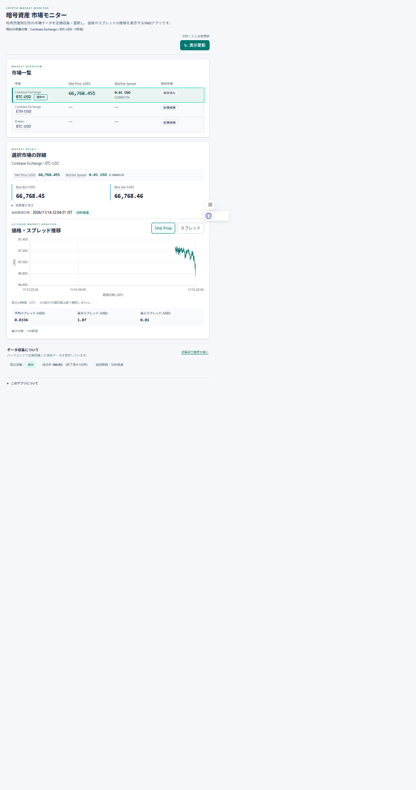
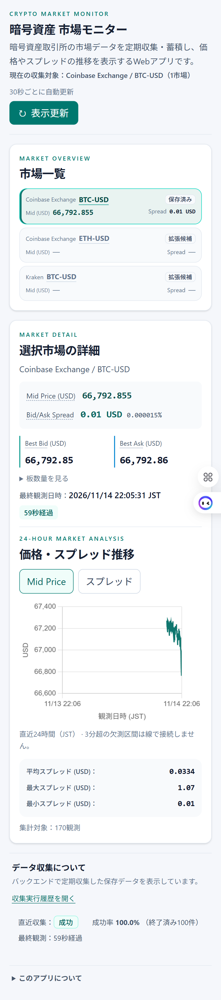
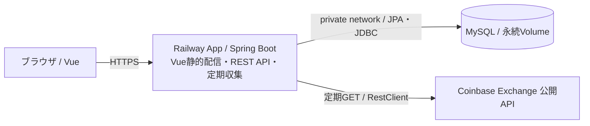

# Crypto Market Monitor

暗号資産取引所の市場データを定期収集・蓄積し、最新価格・直近24時間の価格推移・Bid/Askスプレッド統計を表示するWebアプリです。現在は **Coinbase Exchange / BTC-USDの1市場**を収集しています。実際の売買・裁定取引は行いません。

**[公開デモ：暗号資産 市場モニター](https://app-production-d13c7e57.up.railway.app/)** · [CI結果](https://github.com/Omelette4897/crypto-market-monitor/actions/workflows/ci.yml) · [資料一覧](docs/資料一覧.md)

デモは停止する場合があります。停止中は収集されず、再開後も欠測を補間しません。画面の更新は保存済みデータの再取得です。



<details>
<summary>スマートフォン表示</summary>



</details>

撮影：2026-11-14。公開アプリの実データで、価格・観測件数は撮影時点のものです。

## 主な機能

- CoinbaseのLevel 1注文板からBest Bid / Ask・数量を取得し、検証後にMySQLへ保存。
- 起動時の未完了収集回復と、前回処理終了から60秒後の定期収集。
- 最新価格、収集実行履歴、24時間の価格履歴・スプレッド統計を返す3つのGET API。
- Mid Price / Spread切替チャート、鮮度警告、収集履歴の展開・ページ送り。
- 30秒間隔の画面更新。領域ごとの通信失敗を表示し、最後に取得できた値を保持。

一覧のCoinbase ETH-USD / Kraken BTC-USDは表示上の拡張候補です。選択すると未収集と案内し、架空の価格や候補市場へのAPI通信は発生させません。

## 技術スタック

| 領域 | 技術と役割 |
|---|---|
| バックエンド | Java 21 / Spring Boot 3.5.16：REST API、RestClientによる外部取得、TaskSchedulerによる定期実行 |
| データ保存 | MySQL 8.4.13 / Spring Data JPA：保存・検索・集計、Flyway：スキーマ管理 |
| フロントエンド | Vue 3 / TypeScript / Vite / Tailwind CSS：画面・状態管理、Chart.js：推移表示、decimal.js：十進計算 |
| テスト | JUnit / Mockito / MockMvc / Testcontainers、Vitest / Vue Test Utils |
| ビルド・運用 | Maven Wrapper / Docker / GitHub Actions CI、Railway：App・MySQL・永続Volume |

## システム構成



本番はVueをJARへ同梱し、画面とAPIをSpring Bootから配信します。ローカル開発ではVite（5173番）がAPIをSpring Boot（8080番）へ転送し、MySQLだけをDocker Composeで起動します。収集と画面の参照は独立しています。[構成・データフロー](docs/02_基本設計/アーキテクチャ概要.md)

## 設計上の工夫

| 課題 | 採用した設計・根拠 |
|---|---|
| 外部通信待ちでDBトランザクションを長く保持しない | 開始履歴を先にcommitし、HTTP取得をTx外で実行。観測INSERTとSUCCESS更新を同一Txで確定。[保存Service](backend/src/main/java/com/example/cryptomonitor/collection/service/CollectionPersistenceService.java) |
| 保存結果不明時に確定済みの成功を壊さない | 完了更新はRUNNINGを条件とする。commit応答喪失後のFAILED記録でもSUCCESSを上書きしない。[保存・ロールバック試験](backend/src/test/java/com/example/cryptomonitor/collection/service/CollectionPersistenceIT.java) |
| 起動時回復と新規収集の競合を避ける | 回復Txのcommit後に収集を登録。Spring標準Schedulerと終了ライフサイクルで直列実行・停止待機を制御。[起動Runner](backend/src/main/java/com/example/cryptomonitor/collection/startup/CollectionStartupRunner.java)・[ライフサイクル試験](backend/src/test/java/com/example/cryptomonitor/collection/scheduler/CollectionLifecycleTest.java) |
| 価格精度と観測時刻の意味を維持する | BigDecimal / DECIMAL(30,12)、JSON数値文字列、Instant / UTC、DB保存時のみマイクロ秒へ切捨て。提供元時刻を受信時刻で補わない。[共通観測](backend/src/main/java/com/example/cryptomonitor/market/model/MarketObservation.java) |
| グラフ上限と統計の母集団を混同しない | 最新2,000件と24時間全観測のDB集計を同一REPEATABLE_READの参照Txで取得。関連はfetch joinで取得しN+1を避ける。[履歴検索Service](backend/src/main/java/com/example/cryptomonitor/market/service/QuoteHistoryQueryService.java) |

代替案・制約・対応するテストは[主要な設計判断](docs/02_基本設計/主要な設計判断.md)にまとめています。

## テスト・CI

| 種類 | 実体・検証対象 |
|---|---|
| JUnit / Mockito・模擬HTTP / MockMvc | 価格検証、通信エラー、収集進行、JSON契約、Spring起動・終了制御。通常試験は実Coinbase・DBへ接続しない |
| Testcontainers | 専用MySQLでFlyway、制約、commit / rollback、検索・集計、回復・終了時のDB存続を検証 |
| Vitest / Vue Test Utils | 計算・書式、応答検証、タイマー・部分失敗、画面操作。実ブラウザのレイアウト試験とは別 |
| Vue同梱配信 / Docker build | 本番ビルドしたHTML・JS・CSSとAPIの共存、Linuxマルチステージイメージ構築 |

PR作成・更新とmain更新時にBackend / Frontendの2ジョブを実行します。**CIはイメージ構築までで、レジストリ送信・デプロイ・自動マージは行いません。** [CI手順と確認済み実績](docs/05_テスト/CIの実行と確認.md)

公開環境ではPC・スマートフォンの基本操作、定期収集、App / MySQL停止・再開後のデータ保持を確認しています。通信障害の全シナリオ、長時間負荷、全ブラウザ、実行中の強制終了を網羅したものではありません。[ST/UAT結果・未確認事項](docs/05_テスト/本番配信・ST_UAT確認.md)

## ローカル起動

JDK 21、Node.js（CIは24系、対応範囲は[package.json](frontend/package.json)）、Docker Engine / Composeが必要です。Maven・MySQLの個別インストールは不要です。

```sh
# リポジトリ直下：ローカル資格情報を生成し、MySQLを起動
node scripts/init-local-env.mjs
docker compose up -d --wait

# 別ターミナル：バックエンド
cd backend
./mvnw spring-boot:run

# さらに別ターミナル：フロントエンド
cd frontend
npm ci
npm run dev
```

[http://127.0.0.1:5173/](http://127.0.0.1:5173/)を開きます。Windows PowerShellでは`./mvnw`を`.\mvnw.cmd`、`npm`を`npm.cmd`へ読み替えます。[IDE・停止・トラブル対応](docs/04_開発環境/ローカル起動手順.md)

通常起動は実Coinbaseへ接続して保存します。`COLLECTION_ENABLED=false`で収集は無効化できますが、起動時回復は行います。同じDBを使うバックエンドは1プロセスにしてください。生成した`.env`はGit管理対象外です。

テストはbackendで`./mvnw verify`、Docker利用時は`./mvnw -Pmysql-it verify`。frontendで`npm test`と`npm run build`（型チェック込み）を実行します。

## 詳細ドキュメント

| 確認したいこと | 資料 |
|---|---|
| 全体像・主要フロー | [アーキテクチャ概要](docs/02_基本設計/アーキテクチャ概要.md) |
| 採用理由・トレードオフ・実装根拠 | [主要な設計判断](docs/02_基本設計/主要な設計判断.md) |
| 対象範囲 / DB・状態 / JSON契約 | [要件](docs/01_要件定義/要件定義.md)・[基本設計](docs/02_基本設計/基本設計.md)・[API](docs/02_基本設計/API基本設計.md) |
| 機能別クラス・画面・テスト | [資料一覧](docs/資料一覧.md) |
| 本番構成・費用・更新・停止 | [デプロイ設計](docs/06_リリース・運用/公開構成・デプロイ設計.md)・[運用手順](docs/06_リリース・運用/Railwayデプロイ・運用手順.md) |

## 制限・今後の構想

- 実収集は1市場のみ。スプレッドは同一市場のAsk−Bidであり、取引所間の裁定利益ではありません。
- 観測時刻はHTTP本文受信完了時刻です。提供元時刻`sourceAt`はnullで、真の市場鮮度を保証しません。
- 単一App / DB前提。更新は旧App停止完了後に新Appを起動し、短時間の停止を許容します。分散排他・無停止更新は未実装です。
- 履歴検索は一覧上限を設けていますが、DB走査量の上限ではありません。大量蓄積時の索引・保存期間・性能評価は今後の課題です。
- バックアップ・復元試験はPhase 1の対象外です。データ消失時は新規収集から再開し、過去の観測は復元できません。
- 複数市場の実収集・比較、手数料を考慮した裁定候補検出は今後の構想です。

## 開発について

設計検討・実装・テスト・資料整備にCodex等のAI支援を利用しています。重要な仕様と採用判断を開発者が確認し、生成物はコードレビュー・自動テスト・実環境確認で検証しています。各試験の保証範囲と未確認事項は資料に明示しています。
