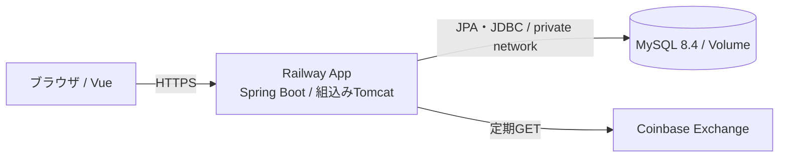
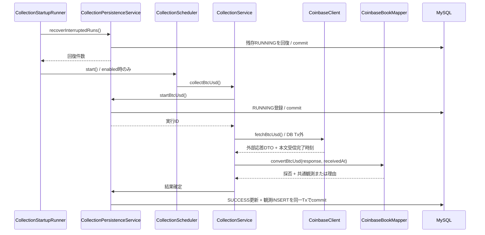
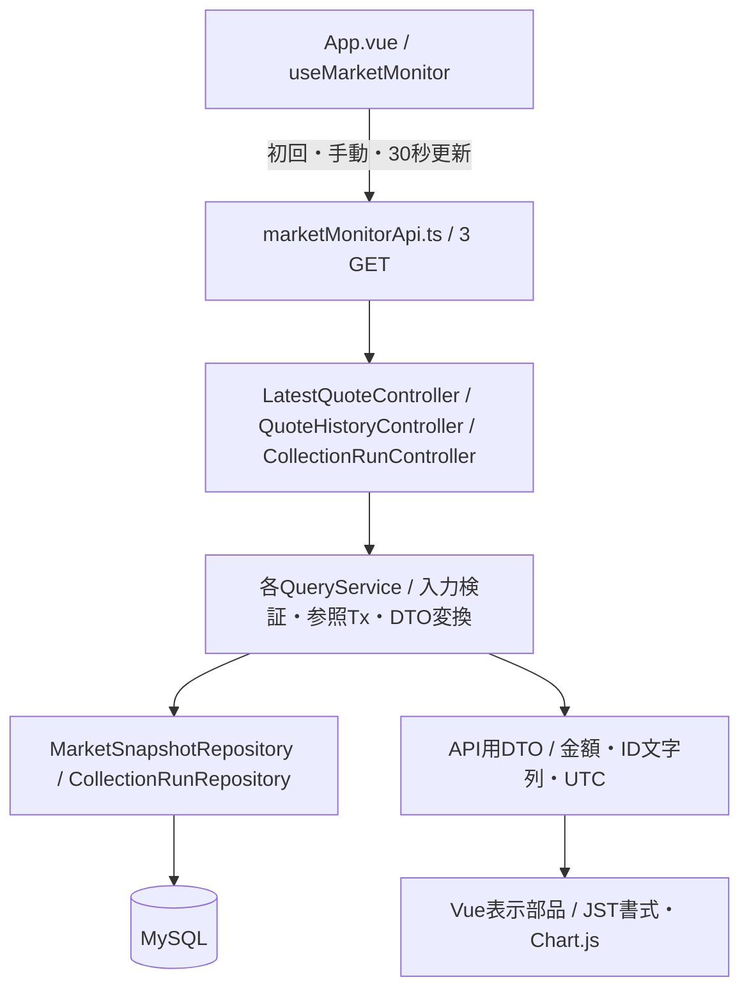
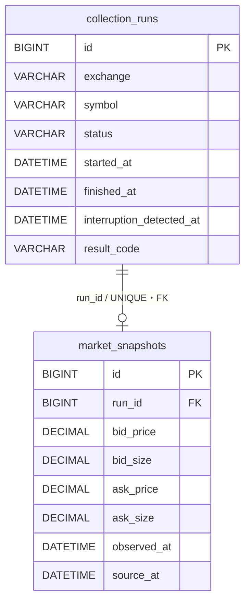

# アーキテクチャ概要

本書は現行実装の構成とデータフローの入口。DB項目・状態定義は[基本設計](基本設計.md)、JSONは[API基本設計](API基本設計.md)を参照する。

## 配置

AppはDockerのマルチステージビルドでVueをJARのstaticへ同梱する。実行イメージはJREとJARのみで非root実行。TLS終端はRailway、本アプリのHTTP待受けは環境変数PORTを使う。独立したNginxやViteは本番で起動しない。

開発時はWindows等のホスト上でViteとSpring Bootを別プロセスとして起動し、ComposeのMySQLへ接続する。Viteの`/api`・`/actuator`プロキシが8080番へ転送する。WindowsのDocker DesktopはLinuxコンテナ実行基盤を提供する。TestcontainersのMySQLは開発用とは別である。

## 収集フロー：外部データを保存する

図の最終行は採用時。SKIPPED / FAILEDでは価格観測を作らず履歴を確定する。開始登録失敗ならHTTPへ進まない。結果保存失敗後は別TxでRUNNINGのみFAILEDへ更新を試み、DB記録不能ならログへ残す。

基盤はSpring `ThreadPoolTaskScheduler`（1スレッド）。起動時回復のcommit後に初回を予約し、各処理終了から60秒後に次回を実行する。停止時は次回を取消し、実行中の収集へ最大30秒の猶予を与える。詳細は[定期実行・終了設計](../03_詳細設計/Phase1_定期実行・起動時回収_詳細設計.md)。

## 参照フロー：保存済みデータを表示する

ControllerはHTTP入口、Serviceは検索条件・期間・DTO作成、Repositoryは検索・集計、EntityはDB対応を担当する。Entityを直接JSONへ公開しない。GETはCoinbaseClientや保存Serviceを呼ばず、収集周期とも独立する。

フロントは通信・応答検証、画面状態、表示部品、表示計算を分離する。最新価格・履歴・分析の取得は独立し、一部失敗しても成功領域を更新し前回値を保持する。

## 保存データと境界

1実行につき観測は0または1件。同じ価格でも新しい実行として保存する。成功と観測の対応はDB制約だけでなく保存ServiceのTxで守る。DDLの型・CHECK・照合順序は[Flyway V1](../../backend/src/main/resources/db/migration/V1__create_collection_runs.sql)・[V2](../../backend/src/main/resources/db/migration/V2__create_market_snapshots.sql)が正本。

MySQLはprivate接続のみ、Appは専用ユーザーで接続する。設定・秘密値は外部環境変数へ分離する。単一Appが前提で、新旧Appを同じDBへ並行起動しない。[運用手順](../06_リリース・運用/Railwayデプロイ・運用手順.md)
